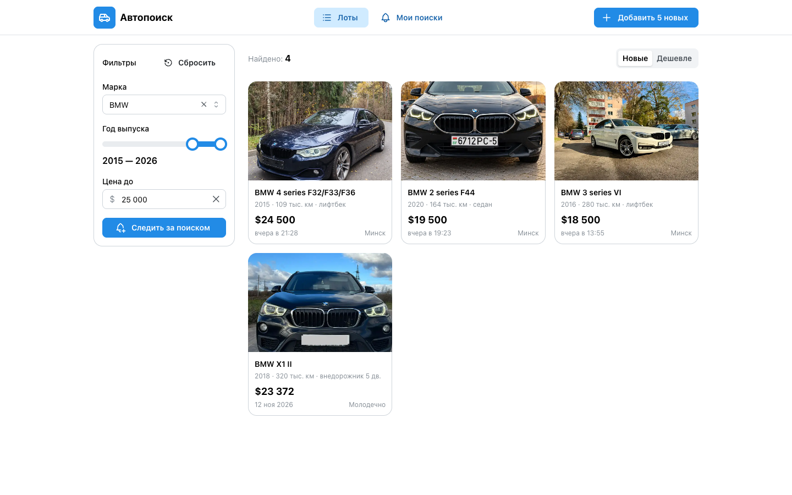
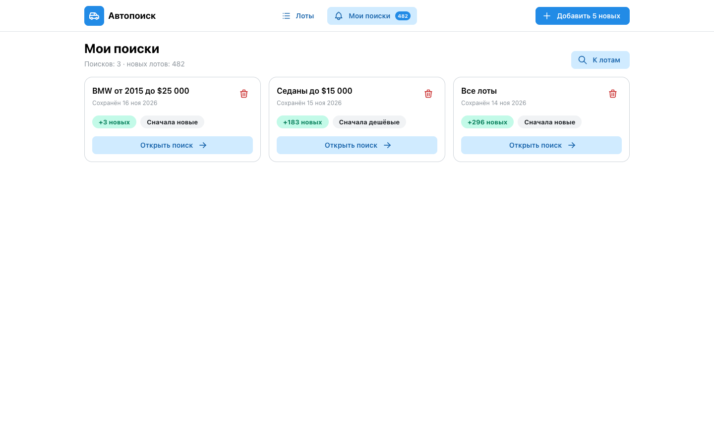

# Автопоиск — сохранённые поиски авто

Тестовое задание WestMotors: витрина автомобилей с фильтрами, сортировкой и
сохранёнными поисками. Приложение показывает, сколько новых лотов появилось после
сохранения поиска, и умеет имитировать появление новых объявлений.

React 19 · TypeScript 7 · Vite 8 · Mantine 9 · React Router 7 · Vitest.

**Демо:** [11alone11.github.io/autosearch](https://11alone11.github.io/autosearch/) ·
**Репозиторий:** [github.com/11Alone11/autosearch](https://github.com/11Alone11/autosearch)

- [Спецификация](docs/spec.md) — нормативное описание поведения.
- [Код-стиль](docs/style.md) — структура, соглашения и проверки.
- [AGENTS.md](AGENTS.md) — краткие наставления для работы с репозиторием.

## Скриншоты

| Мобильный каталог | Фильтры в нижней шторке |
| --- | --- |
|  |  |

| Мои поиски | Скелетоны загрузки |
| --- | --- |
|  |  |

| Десктоп: фильтры и сетка | Десктоп: мои поиски |
| --- | --- |
|  |  |

## Что умеет

- 300 объявлений: марка, модель, год, цена в долларах, пробег, кузов, город,
  дата появления и фотография. Если фото не загрузилось, подставляется случайное
  фото из каталога — заглушки «Фото недоступно» нет.
- Фильтры: марка, год от–до, цена до. Сортировки: «сначала новые» и «сначала дешёвые».
  При смене фильтров или сортировки каталог плавно возвращается к началу списка.
- «Следить за поиском» сохраняет фильтры и сортировку; одинаковый поиск дважды не создаётся.
- «Мои поиски»: список, удаление с отменой, счётчик новых лотов и переход в поиск
  с обнулением счётчика.
- «Добавить 5 новых лотов» — имитация появления объявлений: они сразу попадают в каталог
  и в счётчики.
- Адаптив от 320 px: на телефоне фильтры открываются в нижней шторке, навигация —
  нижние вкладки, каталог — одна карточка в ряд.
- Пока данные грузятся, показываются скелетоны карточек, фильтров, тулбара и счётчика;
  у каждой фотографии скелетон до загрузки.
- Фильтры в шторке — черновик: список пересобирается по кнопке «Показать N», а не на
  каждое движение пальцем.
- Аккуратные состояния: наведение, фокус, нажатие, отключённые элементы, пустые списки,
  ошибки хранилища и ошибка загрузки данных с кнопкой «Повторить».
- На телефоне панель «фильтры — найдено — сортировка» липнет под шапкой, уезжает при
  прокрутке вниз и возвращается при прокрутке вверх.
- Цена вводится без маски и фиксируется по blur/Enter; год применяется по отпусканию
  слайдера.
- Даты в карточках: «сегодня в 21:01», «вчера в 21:45», дальше конкретная дата.
- Семантическая разметка (`header`, `nav`, `main`, `section`, `article`, `h1`–`h2`) и
  базовое SEO: у каждой страницы свой `title` и `description`, Open Graph, Twittercard,
  favicon и apple-touch-icon.

## Быстрый старт

Нужен Node.js 22.12+.

```bash
npm ci
npm run dev
```

Приложение откроется на `http://localhost:5173`.

| Команда | Что делает |
| --- | --- |
| `npm run dev` | дев-сервер Vite |
| `npm run build` | typecheck + прод-сборка в `dist/` |
| `npm run preview` | просмотр собранной версии |
| `npm test` | vitest, 92 теста |
| `npm run typecheck` | `tsc -b` |
| `npm run lint` | oxlint |
| `npm run data` | перегенерировать `lots.json` и фото из API |
| `npm run icons` | перегенерировать favicon, PNG-иконки и OG-картинку |
| `npm run check:grid` | сетка 4 px и паритет скелетонов; нужен dev-сервер и Chromium Playwright (или `CHROME_PATH`) |

## Как устроено

```text
src/
  data/lots.json          300 лотов; генерируются скриптом, руками не правятся
  lib/                    чистая логика без React: фильтры, сортировки, счётчики,
                          форматирование, генератор новых лотов, метаданные страниц
  state/                  localStorage, списки поверх него и хуки к ним
  hooks/                  переиспользуемые хуки без доменной логики
  components/
    layout/               AppShell, шапка и нижняя навигация
    lots/                 карточка, фото, тулбар, «Добавить 5»
    filters/              марка, диапазон годов, цена, сброс
    searches/             карточка сохранённого поиска
    ui/                   пустое состояние и скелетоны
  pages/                  каталог, «Мои поиски», 404
  styles/global.css       дизайн-слой: токены, переходы, ховеры, reduced-motion
  theme.ts                тема Mantine: курсор, радиусы, дефолты компонентов
  routes.tsx              маршруты для приложения и тестов
scripts/
  fetch-lots.ts           сбор данных из API и пережатие фото
  lib/abwDate.ts          парсер дат abw.by
  lib/abwLot.ts           разбор марки, модели и пробега
  check-grid.mjs          проверка сетки и скелетонов в браузере
  make-icons.mjs          favicon.svg, PNG-иконки и og.png из одного источника
docs/
  spec.md                 нормативная спецификация
  style.md                код-стиль
```

Логика отделена от React намеренно: фильтрация, сортировка и подсчёт новых — чистые
функции, которые тестируются без DOM. Компоненты отвечают только за отображение и
вызовы из `lib`/`state`, а `localStorage` живёт только в `state`.

## Данные

`scripts/fetch-lots.ts` (`npm run data`):

1. забирает страницы 1–20 API `b.abw.by` по 20 объявлений и дедуплицирует по `id`;
2. разбирает марку, модель, год, цену, пробег, кузов и город;
3. берёт первую фотографию объявления и пережимает её в webp 640×480, q70;
4. отбрасывает объявления без фотографии и добирает следующие;
5. пишет `src/data/lots.json` и удаляет лишние файлы из `public/photos`.

Данные берутся с abw, чтобы карточки выглядели реалистично: реальные марки,
модели и фото.

`appearedAt` — это `updated_at` из API, ближайший доступный аналог даты появления.
Формат даты у источника бывает разным, поэтому парсер `scripts/lib/abwDate.ts`
покрыт тестами и имеет детерминированный fallback.

Снимок в репозитории — на 19 ноября 2026: 300 лотов, 300 фотографий, 52 марки.
`npm run data` обновляет и данные, и фотографии.

Данные и фотографии — демонстрационное наполнение из открытого API; права на
исходные материалы принадлежат источнику. `lots.json` и `public/photos/*` меняются
только скриптом.

## Решения

**localStorage вместо бэкенда.** В задании был выбор. Для статического приложения
это убирает сеть, CORS, деплой базы и обработку серверных ошибок. Логика изолирована:
для переезда на бэкенд достаточно заменить `src/state/*`, компоненты и `lib/` не меняются.

**Базовые лоты — в бандле, в хранилище только дельты.** 300 лотов в localStorage —
лишний риск переполнения. Там лежат только сохранённые поиски и добавленные лоты;
при превышении лимита старые удаляются, пользователь получает уведомление.

**Новый лот — по времени, а не по id.** `newCount` считает лоты, которые подходят под
фильтры и появились после `lastSeenAt`. Это устойчиво к удалению и повторному
добавлению лотов. Если новых нет, показывается «Нет новых», а не пустое место.

**HashRouter.** На GitHub Pages `BrowserRouter` требует копии `index.html` в `404.html`.
Hash работает из коробки и не зависит от настроек хостинга.

**Фильтры в query-параметрах.** Ссылку можно переслать, F5 не сбрасывает состояние,
кнопка «назад» работает ожидаемо. Запись идёт с `replace: true`, чтобы каждый ввод
не плодил запись в истории.

**Mantine и один дизайн-слой.** Mantine даёт доступные `AppShell`, `Drawer`,
`SegmentedControl`, `RangeSlider` и `Select`. Свой CSS — только `src/styles/global.css`
(токены, переходы, ховеры, `prefers-reduced-motion`) и `src/theme.ts`. Tailwind и
других UI-китов нет.

**Сетка 4 px и скелетоны.** Шапка и навигация 64 px, контролы 36 px, тулбар 52 px,
карточка 296 px, панель фильтров 368 px. Рамки нарисованы `box-shadow`, чтобы не
добавлять 2 px к высоте. Скелетоны совпадают с живыми блоками; проверка —
`npm run check:grid`.

**Цена и год без дёрганья.** Слайдер годов держит значение локально и отдаёт его
в фильтры по `onChangeEnd`. Цена не форматируется, пока поле в фокусе; фильтр
применяется адаптивно с паузой 250 мс и фиксируется по blur/Enter. Первое значение
тоже проходит через паузу, чтобы каталог не мигал на первой цифре.

**Пагинация по 60 карточек.** 300 карточек с фотографиями в DOM — лишняя работа для
телефона. «Показать ещё» дешевле и не мешает фильтрам.

**Детерминированные сортировки.** У каждой сортировки есть второй ключ: при равных
ценах или датах порядок не меняется между рендерами.

**Шторка фильтров — черновик.** На телефоне фильтры применяются по кнопке
«Показать N», «Следить» применяет и сохраняет. На десктопе фильтры применяются сразу:
там есть мышь и место, чтобы видеть результат.

**SEO — по возможностям статики.** Приложение — SPA с `HashRouter`: у маршрутов нет
отдельных HTML-документов, поэтому sitemap для них бесполезен, а SSR потребовал бы
отдельной сборки. Сделано то, что работает без сервера: `lang="ru"`, description,
robots, Open Graph и Twittercard, семантические лендмарки, иерархия заголовков
и собственные `title`/`description` у каталога, «Моих поисков» и 404
(`src/lib/pageMeta.ts`). `canonical`, `og:url` и `og:image` на сборке становятся
абсолютными: адрес берётся из `SITE_URL` или вычисляется из `GITHUB_REPOSITORY`
(`vite.config.ts`), локально остаётся путь от `base`. `sitemap.xml` и `robots.txt`
не добавлены: на GitHub Pages проект живёт по пути `/<repo>/`, а hash-маршруты
не индексируются как отдельные страницы. Для своего домена задайте `SITE_URL`
и подключите домен в настройках Pages; SSR — отдельная история.

**React Compiler и скролл.** Включён `compiler: true`, поэтому ручной `memo` не нужен.
Тулбар скрывается классом через ref, без состояния React: прокрутка не вызывает
перерендеров списка.

## Тесты

`npm test` — 92 теста на vitest + Testing Library:

- парсер дат abw.by (5 форматов и fallback) и разбор марки/модели/пробега;
- фильтрация, границы диапазонов, перепутанные годы;
- заголовки и описания страниц, включая 404 и завершающий слэш;
- сортировки и их детерминированность;
- счётчик новых лотов и нормализация фильтров;
- генератор новых лотов и его ограничения;
- чтение/запись localStorage, битый JSON, квота, лимит добавленных лотов;
- случайное фото для карточки с недоступной фотографией и его исключение;
- UI-сценарии: фильтр по цене, «Добавить 5», сохранение поиска, фильтры из шторки
  применяются только по кнопке, очистка цены отменяет отложенное применение,
  прокрутка к началу списка при смене фильтра;
- полный цикл «сохранил → добавил 5 → счётчик +5 → открыл → счётчик обнулился»
  и удаление поиска с возвратом.

E2E и визуальных регрессий в репозитории нет: браузерные проверки (320/390 px,
отсутствие горизонтального скролла, скриншоты) выполнялись вручную.

## Деплой

Сайт опубликован: [11alone11.github.io/autosearch](https://11alone11.github.io/autosearch/)
(GitHub Pages, источник — GitHub Actions).

В репозитории два workflow:

- `.github/workflows/ci.yml` — lint, typecheck, test, build на push и pull request;
- `.github/workflows/deploy.yml` — те же проверки и публикация `dist` на GitHub Pages.

`base` вычисляется из `GITHUB_REPOSITORY`, локально — `/`. Если задана переменная
репозитория `SITE_URL`, из неё берутся и `base`, и абсолютные canonical/OG-адреса;
без неё адрес выводится из `GITHUB_REPOSITORY`. Workflow передаёт `SITE_URL` в сборку
из Settings → Secrets and variables → Actions → Variables. Приложение использует
hash-роутер, поэтому дополнительная настройка `404.html` не нужна.

### Публикация с нуля

1. Создайте на GitHub пустой публичный репозиторий — без README, `.gitignore` и лицензии.
2. Добавьте remote и отправьте `main`:

   ```bash
   git remote add origin https://github.com/<owner>/<repo>.git
   git push -u origin main
   ```

3. Settings → Pages → Build and deployment → Source: **GitHub Actions**.
4. Actions → **Deploy to GitHub Pages**. Сайт появится на
   `https://<owner>.github.io/<repo>/`; для репозитория `<owner>.github.io` — в корне.

Если в репозитории уже есть коммиты, историю заменяет `git push --force -u origin main`.
Pages для приватного репозитория доступен только на платном плане.

## Трудности

Больше всего времени ушло не на фичи, а на доведение мелочей. Вёрстка: сетка 4 px
и паритет скелетонов ломались от лишнего `border`, неверного `line-height` или
отступа — высоты приходилось пересчитывать. Поведение: слайдер и цена дёргали
список на каждое событие, а лишние перерендеры — прокрутку; помогли локальные
черновики, `onChangeEnd`/debounce и отказ от состояния React в скролл-хуке.
Логика: краевые случаи нормализации фильтров, дублей поисков и счётчика новых
ловились не сразу. Отдельная боль — Mantine `Select` и поповеры в липкой панели
и шторке: позиционирование и поведение при скролле пришлось чинить несколько раз.

## Время и ИИ

На разработку ушло около 4 часов, ещё примерно 30 минут — ручное тестирование:
прошёл сценарии, потыкал фильтры, посмотрел мобильную вёрстку и состояния.

Разработка полностью агентская: код писал DeepSeek, и это не быстро. Не один
запрос «сделай», а несколько отдельных проходов — план, реализация, тесты,
ревью агентом, затем ручное ревью глазами. Почти всё это время — циклы с агентом:
постановка, запуск, ожидание, проверка, следующая правка. Отдельное ревью агентом
тоже занимает время; быстрее всего шли типовые куски, дольше всего — мелкие правки
по результатам проверки.

Почему так: вручную это заняло бы заметно больше времени. Другие проекты
WestMotors я смотрел как ориентир: агентский подход там заметен, но результат
всё равно проверялся руками.

## Что не успел / что дальше

- **Виртуализация списка.** Сейчас «Показать ещё» по 60 карточек; при тысячах лотов
  можно включить виртуализацию. Пагинация — равнозначный вариант, и текущий
  «Показать ещё» уже к ней близок.
- **Тёмная тема.** Mantine к ней готов, но нужен прогон по всем экранам и состояниям.
- **Мелкие нюансы дизайна.** Не все отступы и выравнивания доведены до идеала:
  где-то гуляют 2–4 px, подписи и иконки в шапке и шторке можно посадить точнее,
  на нестандартных ширинах возможны переносы, которые не проверялись.
